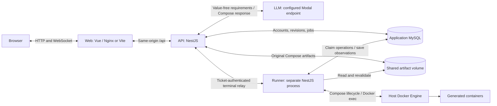
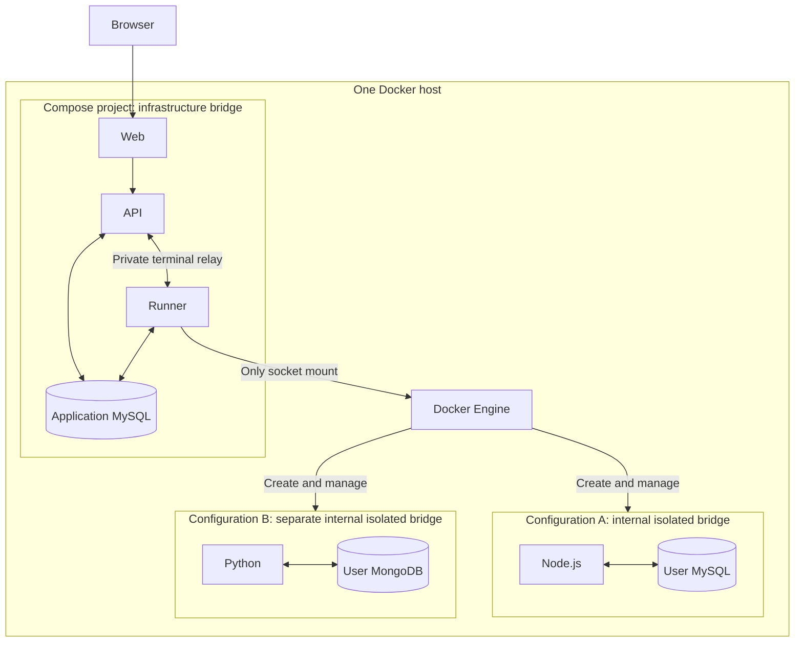

# Docker Image Creator

A local Vue + NestJS application that turns service selections and instructions into a validated Docker Compose configuration. Users register with email/password, supply environment values, review the generated YAML, explicitly Start/Stop their configuration, and open interactive container terminals. MySQL stores accounts, revisions, encrypted values, and durable operations.

Supported images: Node.js, Python, MySQL, and MongoDB. Generation never starts containers automatically. The current LLM adapter uses a Chat Completions endpoint through the OpenAI SDK.

## Local setup

Requires Linux Docker Engine 28+ with isolated bridge/resource enforcement and Docker Compose v2.29.1+ within v2. Docker builds the application; host Node/pnpm is optional.

From the repository root:

1. Create a private `.env` from the secret-free [.env.example](.env.example). Preserve existing settings on upgrades. Set MySQL passwords and a matching, URL-encoded `DATABASE_URL`; use separate random signing and encryption keys. `CONFIG_ENCRYPTION_KEY` must be 64 hexadecimal characters (`openssl rand -hex 32`).
2. Configure `OPENAI_BASE_URL` (HTTPS API base including `/v1`), `OPENAI_API_KEY`, and `OPENAI_MODEL` for your endpoint. Missing inference settings allow startup but fail generation explicitly.
3. Match `AUTH_TRUSTED_ORIGINS` to the browser address. The example uses `WEB_PORT=80` and `http://127.0.0.1`; Compose defaults to port 8080 if unset.
4. Prepare API logs and start the application:

```bash
mkdir -p -m 700 .runtime/llm
docker compose --env-file .env -f infra/docker-compose.yml up --build -d --wait
```

The log directory must be writable by API UID 1000 on Linux. Open <http://127.0.0.1> with the example settings, or <http://127.0.0.1:8080> with the Compose default. Register, create a configuration, supply all required values, generate, review, then Start. Repeated login is required after a page reload.

For Vue HMR and API reloads, use:

```bash
docker compose --env-file .env -f infra/docker-compose.yml -f infra/docker-compose.dev.yml up --build -d --wait
```

The runner uses compiled code and requires rebuilding after runtime/prompt changes. [Local setup](docs/local-setup.md) covers environment settings, source development, health checks, and stopping services.
## System and information flow



1. Web submits authenticated service requirements and supplied values. API checks ownership, encrypts values, saves a generation job, and returns an ID for polling.
2. The API generation worker sends the LLM only service choices, instructions, policy, and opaque environment references. Actual supplied values stay private. It validates one model response; invalid output fails without content repair or a generated fallback.
3. On success, API saves the original YAML bytes, digest, and derived metadata as an immutable revision and private artifact. Start is a separate user action.
4. API commits a runtime operation. Runner claims it from MySQL, revalidates the revision, decrypts required values for Start, and executes the same Compose bytes. It records observations for API polling. Stop preserves named volumes.
5. Connect obtains a one-use ticket. API relays the browser terminal to runner, which authorizes a Docker exec TTY inside the selected running container.

Only runner has Docker daemon access. `apps/runner` packages the worker whose implementation lives in `apps/api/src/runtime`; `packages/contracts` shares transport types and input rules with Vue. See [architecture](docs/architecture.md) for durability and trust boundaries.

## Docker networking



Each configuration gets one project-scoped `stack` bridge shared by its services. Services find each other by Compose service name and container port. Networks use `internal: true`, isolated IPv4 gateway mode, and disabled IPv6; workloads have no published ports. They cannot reach another configuration, application infrastructure, host services, or the internet under the enforced policy. Engine management arrows above represent Docker control operations, not workload network connections. Runner can pull approved images independently of workload networking.

Application MySQL and generated MySQL are separate containers with separate volumes and networks. Web is the only published application service; API, runner, and application MySQL stay private. Terminals use Docker exec and require no published workload port.

## Evaluation

Run the ten-case benchmark explicitly inside an idle runner, after configuring the endpoint/model/key and rebuilding its image:

```bash
docker compose --env-file .env -f infra/docker-compose.yml exec runner node dist-evaluation/evaluation/cli.js
```

Evaluation shares the provider, validator, and Docker driver, but creates no application database records. Cases run sequentially with disposable values/resources and one model response each. It reports **policy acceptance**, **healthy startup**, and **independent task success**, each out of ten. Startup gets 120 seconds plus ten seconds remaining healthy; trusted probes check behavior beyond model-authored health checks. Cleanup is reported separately.

| Case | What it checks                                                                                                                   |
| ---- | -------------------------------------------------------------------------------------------------------------------------------- |
| C01  | Node.js HTTP health and exact supplied message.                                                                                  |
| C02  | Python HTTP health and exact supplied message.                                                                                   |
| C03  | MySQL database, application/root authentication, and wrong-password rejection.                                                   |
| C04  | MongoDB authenticated ping, database setting, and wrong-password rejection.                                                      |
| C05  | Node.js → MySQL DNS/TCP readiness, shared password delivery, database authentication, and readiness failure after database stop. |
| C06  | Python → MongoDB DNS/TCP readiness, shared password delivery, authentication, and readiness failure after database stop.         |
| C07  | Node.js gateway fetches a Python service's message by service name.                                                              |
| C08  | MySQL and MongoDB use distinct supplied credentials.                                                                             |
| C09  | MySQL preserves special-character credentials and a row across Stop/Start.                                                       |
| C10  | All four images stay healthy together; HTTP, database authentication, DNS/TCP, and value delivery pass.                          |

Reports persist in `.runtime/evaluations/<runId>/`: `terminal.log`, checkpointed `results.json`, accepted artifacts, and redacted HTTP body traces. Retry interrupted cleanup with the same command plus `--cleanup <runId>`. It performs no generation or Start. See [case assertions](docs/evaluation/compose-cases.md) and [execution/reporting details](docs/evaluation/terminal-runner.md).

## Changes and results

| Change                                                                    | Recorded result                                                                                                             |
| ------------------------------------------------------------------------- | --------------------------------------------------------------------------------------------------------------------------- |
| First live OpenRouter/Gemma baseline                       | Policy/startup/task all **0/10**: one validation failure and nine rate-limit failures              |
| Modal.com/OpenAI SDK transport      | No rate limits, old failure scores reman                  |
| Switch to OpenAI API            | Policy/startup/task all **7/10**                                    |
| MySQL bootstrap reference, prompt v4                                      | Policy/startup/task **10/8/8** out of **10**             |
| MongoDB health-check reference/YAML quoting, prompt v5                    | Policy/startup/task all **10/10**|

The [annotated documentation tree](docs/README.md) maps the repository and detailed references.
